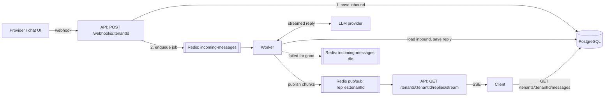

# multitenant-messaging-hub

[](https://github.com/Carlessso/multitenant-messaging-hub/actions/workflows/ci.yml)

A multi-tenant messaging backend in Node.js and TypeScript. Stores receive customer messages through a WhatsApp/Instagram-style webhook, a queue worker generates a reply with an LLM (Gemini) following each store's own bot instructions, and the reply is streamed to the browser in real time over Server-Sent Events.

The messaging providers are simulated: a React chat UI plays the customer and calls the webhook exactly as a provider would. It also shows a live **Backend activity** panel that follows each message through the webhook, the queue, the worker and the LLM, with timings.

## Quick start

The only requirement is Docker.

```bash
git clone https://github.com/Carlessso/multitenant-messaging-hub.git
cd multitenant-messaging-hub
bin/setup
```

Open **http://127.0.0.1:8080**, pick one of the demo stores and chat as a customer. `bin/restart` applies code or `.env` changes, and `bin/stop` stops everything (`--wipe` also deletes the data).

Replies come from a mock LLM by default. To use Gemini, set `LLM_PROVIDER=gemini` and `GEMINI_API_KEY` in `.env` and run `bin/restart`.

## Architecture



The API and the worker are separate processes that never talk to each other directly: the API writes jobs to Redis and the worker consumes them; the worker publishes reply chunks to Redis and the API forwards them to clients. Each process can be scaled, restarted or deployed independently, and jobs wait in the queue while no worker is running.

## Highlights

- **Asynchronous processing.** The webhook validates, stores the message and answers `202` right away; a separate worker does the slow LLM work off the request path.
- **Idempotency in three layers.** Unique `(tenant_id, external_id)` for redelivered webhooks, a deterministic job id for duplicate enqueues and unique `reply_to_id` for jobs that run twice. The guarantee lives in database constraints, so it holds under concurrency.
- **Retries and a dead-letter queue.** 5 attempts with exponential backoff; errors that retrying cannot fix skip the remaining attempts, and jobs that fail for good are kept in a dead-letter queue.
- **Streaming across processes.** Reply chunks travel worker → Redis pub/sub → API → SSE, with heartbeats and listener cleanup. Every LLM call has an `AbortSignal` timeout.
- **Multi-tenancy and auth.** Per-tenant API keys stored as SHA-256 hashes (another tenant's key gets `403`), an admin key compared in constant time, and per-tenant bot instructions placed before fixed guardrails in the prompt.
- **Conversation memory.** The last 10 messages of the conversation are sent to the LLM, so follow-up questions are understood.
- **Observability.** Structured Pino logs with request ids, Prometheus metrics (`GET /metrics`: HTTP latency per route, queue depth, dead-letter size, open SSE connections) and pipeline status events.
- **Tested against real infrastructure.** Vitest + Testcontainers run the API and the job processor against real PostgreSQL and Redis; the LLM is mocked. CI runs format, lint, type checking, tests and the Docker build on every push.

## Tech stack

| Area       | Choice                                                  |
| ---------- | ------------------------------------------------------- |
| Runtime    | Node.js 26, TypeScript (strict), ESM                    |
| HTTP       | Fastify 5 + `fastify-type-provider-zod`                 |
| Validation | Zod 4 (HTTP input, environment variables, Redis events) |
| Database   | PostgreSQL 18 + Prisma 7 (`@prisma/adapter-pg`)         |
| Queue      | BullMQ + Redis 8                                        |
| Streaming  | Redis pub/sub + Server-Sent Events                      |
| LLM        | Gemini (`@google/genai`) behind an `LLMProvider`        |
| Logging    | Pino                                                    |
| Tests      | Vitest + Testcontainers                                 |
| Metrics    | Prometheus (`prom-client`)                              |
| Tooling    | ESLint (type-aware rules), Prettier, Docker Compose     |
| CI         | GitHub Actions                                          |
| Web UI     | React 19 + Vite + TypeScript (`web/`)                   |

## Documentation

- [Design decisions](docs/design-decisions.md): the reasoning behind each choice and the trade-offs accepted.
- [API](docs/api.md): endpoints with `curl` examples, SSE events and the error format.
- [Development](docs/development.md): the Docker services, running the API and worker with Node, Gemini setup, tests and scripts.
