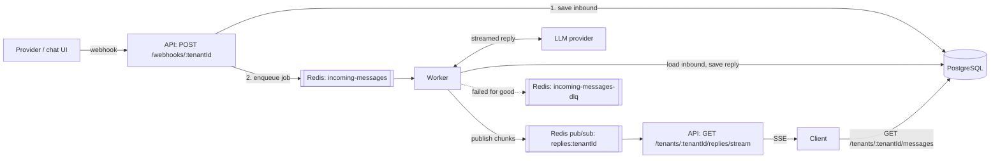

# multitenant-messaging-hub

[](https://github.com/Carlessso/multitenant-messaging-hub/actions/workflows/ci.yml)

A multi-tenant messaging hub built with Node.js and TypeScript. It receives WhatsApp/Instagram-style webhooks, persists every message per tenant and processes it asynchronously through a queue with retry, idempotency and a dead-letter queue. Replies are generated by an LLM (Gemini, or a mock for development and tests) and streamed to clients token by token via Server-Sent Events. Next up: API key auth, Prometheus metrics and a React chat UI.

> **Status:** work in progress. See the [roadmap](#roadmap) for what is done and what is next.
>
> There is no real WhatsApp/Instagram integration: providers are simulated, and the planned React chat UI plays the customer's side by calling the webhook.

## Features

- **Webhook ingestion** — `POST /webhooks/:tenantId` validates the payload with Zod, persists the message (creating or updating the conversation for that contact) and enqueues it for processing.
- **Asynchronous processing** — a separate worker process consumes the queue and stores a reply linked to the incoming message. The webhook answers `202` right away; the heavy work happens off the request path.
- **LLM auto-replies** — the reply text comes from an `LLMProvider`: Gemini in production, a deterministic streaming mock in development and tests. The provider is chosen by `LLM_PROVIDER`, and every call is cancelled after `LLM_TIMEOUT_MS` with an `AbortSignal`, so a slow model can never hang a worker.
- **Streaming via SSE** — `GET /tenants/:tenantId/replies/stream` pushes each piece of the reply to connected clients as soon as the LLM generates it, followed by a `done` event with the full text.
- **Retry and dead-letter queue** — failed jobs are retried with exponential backoff (5 attempts: 1s, 2s, 4s, 8s). Errors that retrying cannot fix fail immediately. Jobs that fail for good are moved to a dead-letter queue with their failure reason, ready to be inspected and replayed.
- **Idempotency end to end** — providers redeliver webhooks and queues deliver jobs at least once, so duplicates are expected and handled at every layer (see [design decisions](#design-decisions)).
- **Multi-tenancy** — every conversation and message belongs to a tenant; unknown tenants get a `404`.
- **Consistent error format** — every error, from validation to unhandled exceptions, uses the same envelope with a `requestId` for tracing.
- **Graceful shutdown** — on `SIGINT`/`SIGTERM` the API finishes in-flight requests and the worker finishes the job in progress before closing their connections.
- **Integration tests against real infrastructure** — Testcontainers spins up disposable PostgreSQL and Redis instances, applies the migrations and exercises the HTTP API and the job processor end to end.

## Tech stack

| Area       | Choice                                              |
| ---------- | --------------------------------------------------- |
| Runtime    | Node.js 26, TypeScript (strict), ESM                |
| HTTP       | Fastify 5 + `fastify-type-provider-zod`             |
| Validation | Zod 4 (HTTP input and environment variables)        |
| Database   | PostgreSQL 18 + Prisma 7 (`@prisma/adapter-pg`)     |
| Queue      | BullMQ + Redis 8                                    |
| Streaming  | Redis pub/sub + Server-Sent Events                  |
| LLM        | Gemini (`@google/genai`) behind an `LLMProvider`    |
| Logging    | Pino                                                |
| Tests      | Vitest + Testcontainers                             |
| Tooling    | ESLint (type-aware rules), Prettier, Docker Compose |
| Planned    | React, metrics, GitHub Actions                      |

## Architecture



The API and the worker are separate processes that never talk to each other directly: the API writes jobs to Redis and the worker consumes them; the worker publishes reply chunks to Redis and the API forwards them to clients. Each process can be scaled, restarted or deployed independently, and jobs wait in the queue while no worker is running.

## Design decisions

- **Feature modules.** Each feature (`webhooks`, `messages`, `tenants`) owns its schemas, routes, repositories and processors.
- **Repository pattern with dependency injection.** Routes and processors depend on _interfaces_. The concrete implementations are created once in each process's composition root (`buildApp()` for the API, `worker.ts` for the worker) and injected, so business code never touches Prisma or BullMQ directly.
- **`buildApp()` vs `server.ts`.** `buildApp(options)` builds the Fastify instance without listening, receiving its configuration as arguments. `server.ts` is the only place that reads the environment, listens on a port and handles signals. Tests call `buildApp()` with Testcontainers URLs and use `app.inject()`, with no open port.
- **Errors as exceptions.** Handlers throw `AppError` subclasses (e.g. `NotFoundError`); a central error handler turns every error into the standard response.
- **Processor vs worker.** `processIncomingMessage` holds the business rule and knows nothing about the queue, so it is tested with just a database. `worker.ts` adapts it to BullMQ: it pulls jobs, logs, retries, moves dead jobs to the DLQ and handles shutdown.
- **Permanent vs transient failures.** A processor throws `PermanentJobError` when retrying cannot help (e.g. the message does not exist). The worker translates it into BullMQ's `UnrecoverableError`, so the job skips its remaining attempts. Any other error is treated as transient and retried with backoff.
- **Jobs carry identifiers, not data.** A job holds only `tenantId` and `externalId`; the database is the source of truth.
- **Idempotency in the database, in three layers.**

  | Layer           | Protects against                                               | Mechanism                         |
  | --------------- | -------------------------------------------------------------- | --------------------------------- |
  | Message storage | Provider redelivering a webhook                                | Unique `(tenant_id, external_id)` |
  | Queue           | Same message enqueued twice                                    | Deterministic `jobId`             |
  | Worker          | Same job executed twice (at-least-once delivery, stalled jobs) | Unique `reply_to_id`              |

  The `jobId` is only an optimization: completed jobs are removed from Redis after an hour, after which the queue no longer remembers them. The guarantee lives in the unique constraints, not in a "check then insert" in application code, so it holds under concurrency.

- **LLM behind an interface.** `generateReply()` returns an `AsyncIterable<string>`, so both the Gemini SDK stream and the mock (an async generator) look the same to the processor. Tests never call the real API: third parties are mocked, the database is not.
- **Timeouts with `AbortSignal`.** The worker creates `AbortSignal.timeout(LLM_TIMEOUT_MS)` per job and passes it down to the provider, which hands it to the Gemini SDK, so the HTTP request itself is cancelled. A timeout is a transient failure and goes through the normal retry. The 60s default comes from measuring the free tier, where the first token took 20–40s.
- **Streaming across processes with Redis pub/sub.** The worker generates the reply but the API holds the client connections, so chunks travel through a Redis channel per tenant. The API keeps a single subscriber connection and fans events out to its SSE clients, subscribing to a channel on the first listener and unsubscribing on the last one, so closed tabs do not leak listeners. Publishing is best effort: if it fails, the reply is still saved and clients can read it from `GET /messages`.
- **SSE details.** The route takes over the raw Node response (`reply.hijack()`), sends a `: ping` comment every 15s so proxies do not drop idle connections, and cleans up on the response's `close` event. Fastify runs with `forceCloseConnections` so graceful shutdown is not blocked by open streams.
- **Known limits of the stream.** Redis pub/sub is fire-and-forget: a client that is not connected misses the events and must load history from `GET /messages`; if a job runs twice, its chunks are streamed twice, and the `done` event carries the full text so clients can reconcile. Backpressure from slow clients is not handled, which is fine for short chat replies. Redis Streams would be the next step for replayable events.
- **Known trade-off: dual write.** The webhook saves to PostgreSQL and then enqueues to Redis, which is not atomic. If enqueuing fails, the provider's retry fixes it, because the route always enqueues, even for a duplicate message. The robust alternative is the transactional outbox pattern.

## Getting started

Requirements: Node.js 26 (`nvm use`), Docker.

```bash
npm install
cp .env.example .env

docker compose up -d        # PostgreSQL on 127.0.0.1:5432, Redis on 127.0.0.1:6379
npm run db:migrate          # apply migrations
npm run db:generate         # generate the Prisma client
npm run db:seed             # create the dev tenants: loja-x, padaria-do-joao

npm run dev                 # API on http://127.0.0.1:3000
npm run dev:worker          # worker, in another terminal
```

By default the worker uses the mock LLM, which needs no API key. To use Gemini, create a key in Google AI Studio and set in `.env`:

```bash
LLM_PROVIDER=gemini
GEMINI_API_KEY=your-key
# GEMINI_MODEL=gemini-3.8-flash
# LLM_TIMEOUT_MS=60000
```

## API

### `POST /webhooks/:tenantId`

```bash
curl -X POST http://127.0.0.1:3000/webhooks/loja-x \
  -H 'content-type: application/json' \
  -d '{
    "externalId": "wamid.123",
    "channel": "whatsapp",
    "from": { "id": "5511999999999", "name": "Maria Silva" },
    "text": "Hi, are you open on Saturday?",
    "sentAt": "2026-11-18T14:30:00.000Z"
  }'
```

```json
{ "received": true }
```

Returns `202 Accepted`: the message is stored and queued, and the reply is produced asynchronously by the worker. `channel` is `whatsapp` or `instagram`, `from.name` is optional and `sentAt` is an ISO 8601 UTC datetime.

### `GET /tenants/:tenantId/messages`

Returns the tenant's messages ordered by arrival. Replies have `direction: "outbound"` and a `replyToId` pointing to the message they answer:

```json
{
  "data": [
    {
      "id": "036e804e-...",
      "tenantId": "loja-x",
      "externalId": "wamid.123",
      "channel": "whatsapp",
      "from": { "id": "5511999999999", "name": "Maria Silva" },
      "text": "Hi, are you open on Saturday?",
      "direction": "inbound",
      "sentAt": "2026-11-18T14:30:00.000Z",
      "receivedAt": "2026-11-18T14:30:01.123Z"
    },
    {
      "id": "2f7cb5c3-...",
      "tenantId": "loja-x",
      "channel": "whatsapp",
      "from": { "id": "5511999999999", "name": "Maria Silva" },
      "text": "Hi! A team member will confirm our Saturday hours shortly.",
      "direction": "outbound",
      "sentAt": "2026-11-18T14:30:01.160Z",
      "receivedAt": "2026-11-18T14:30:01.160Z",
      "replyToId": "036e804e-..."
    }
  ]
}
```

### `GET /tenants/:tenantId/replies/stream`

Server-Sent Events stream of the tenant's replies while they are being generated. Each chunk is sent as soon as the LLM produces it; `done` carries the full text once the reply is saved.

```bash
curl -N http://127.0.0.1:3000/tenants/loja-x/replies/stream
```

```text
: connected

event: chunk
data: {"type":"chunk","replyToId":"036e804e-...","text":"Hi! A team member"}

event: chunk
data: {"type":"chunk","replyToId":"036e804e-...","text":" will confirm our Saturday hours shortly."}

event: done
data: {"type":"done","replyToId":"036e804e-...","text":"Hi! A team member will confirm our Saturday hours shortly."}
```

In the browser: `new EventSource('/tenants/loja-x/replies/stream')` and listen to the `chunk` and `done` events.

### `GET /health`

```json
{ "status": "ok" }
```

### Error format

```json
{
  "error": {
    "code": "VALIDATION_ERROR",
    "message": "Request validation failed",
    "details": [
      {
        "path": "body.channel",
        "message": "Invalid option: expected one of \"whatsapp\"|\"instagram\""
      }
    ],
    "requestId": "req-1"
  }
}
```

| Code               | Status | When                                                   |
| ------------------ | ------ | ------------------------------------------------------ |
| `VALIDATION_ERROR` | 400    | Params or body fail schema validation                  |
| `BAD_REQUEST`      | 4xx    | Malformed request (e.g. invalid JSON)                  |
| `NOT_FOUND`        | 404    | Unknown route                                          |
| `TENANT_NOT_FOUND` | 404    | Unknown tenant                                         |
| `INTERNAL_ERROR`   | 500    | Unexpected failure (details are logged, never exposed) |

## Tests

```bash
npm test              # run once
npm run test:watch    # watch mode
```

- **Unit tests** cover the Zod schemas and the streaming mock LLM.
- **Integration tests** start PostgreSQL 18 and Redis 8 containers with Testcontainers and apply the migrations with `prisma migrate deploy`. They call the API through `app.inject()` and assert the HTTP response, what was persisted and what was enqueued. The SSE test listens on a random port and reads the stream with `fetch`, checking that events reach the right tenant only.
- **Processor tests** call `processIncomingMessage` directly against the database with the mock LLM: reply text, published chunks and `done` event, idempotency when the same job runs twice, a permanent error when the message does not exist, and the timeout aborting a slow LLM without saving a reply.

Docker must be running.

## Scripts

| Script                                   | Description                                      |
| ---------------------------------------- | ------------------------------------------------ |
| `dev` / `dev:worker`                     | Run the API / worker with `tsx watch` and `.env` |
| `build` / `start` / `start:worker`       | Compile to `dist/` and run with plain Node       |
| `typecheck`                              | `tsc --noEmit`                                   |
| `lint` / `format`                        | ESLint / Prettier                                |
| `test` / `test:watch`                    | Vitest                                           |
| `db:migrate` / `db:generate` / `db:seed` | Prisma migrations, client generation and seed    |

## Roadmap

- [x] Project setup: TypeScript strict, ESM, Fastify, ESLint, Prettier
- [x] Webhook and messages endpoints with Zod validation and a standard error format
- [x] PostgreSQL + Prisma + Docker Compose, idempotent message storage
- [x] Tests with Vitest + Testcontainers
- [x] BullMQ queue: async processing with retry, idempotency and dead-letter
- [x] `LLMProvider` interface (Gemini + mock) with the auto-reply streamed via SSE
- [ ] Per-tenant API key auth, structured logs, metrics and CI on GitHub Actions
- [ ] React chat UI: create tenants and chat as a simulated customer
