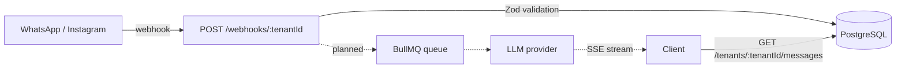

# multitenant-messaging-hub

A multi-tenant messaging hub built with Node.js and TypeScript. It receives WhatsApp/Instagram-style webhooks, persists every message per tenant, and (in progress) processes them through a queue with retry and idempotency, auto-replying with an LLM and streaming the reply via Server-Sent Events.

> **Status:** work in progress. See the [roadmap](#roadmap) for what is done and what is next.

## Features

- **Webhook ingestion** — `POST /webhooks/:tenantId` validates the payload with Zod and persists the message, creating or updating the conversation for that contact.
- **Multi-tenancy** — every conversation and message belongs to a tenant; unknown tenants get a `404`.
- **Idempotent delivery** — providers retry webhooks. A unique constraint on `(tenant_id, external_id)` guarantees a redelivered message is stored only once, and the duplicate still gets `202`.
- **Consistent error format** — every error, from validation to unhandled exceptions, uses the same envelope with a `requestId` for tracing.
- **Graceful shutdown** — on `SIGINT`/`SIGTERM` the server stops accepting connections, finishes in-flight requests and closes the database pool.
- **Integration tests against a real PostgreSQL** — Testcontainers spins up a disposable Postgres, applies the migrations and exercises the HTTP API end to end.

## Tech stack

| Area       | Choice                                               |
| ---------- | ---------------------------------------------------- |
| Runtime    | Node.js 26, TypeScript (strict), ESM                 |
| HTTP       | Fastify 5 + `fastify-type-provider-zod`              |
| Validation | Zod 4 (HTTP input and environment variables)         |
| Database   | PostgreSQL 18 + Prisma 7 (`@prisma/adapter-pg`)      |
| Tests      | Vitest + Testcontainers                              |
| Tooling    | ESLint (type-aware rules), Prettier, Docker Compose  |
| Planned    | BullMQ + Redis, Gemini, Pino metrics, GitHub Actions |

## Architecture



Design decisions:

- **Feature modules.** Each feature (`webhooks`, `messages`, `tenants`) owns its schemas, routes and repositories.
- **Repository pattern with dependency injection.** Routes depend on repository _interfaces_. The Prisma implementations are created once in `buildApp()` and injected through Fastify plugin options, so routes never touch Prisma directly.
- **`buildApp()` vs `server.ts`.** `buildApp(options)` builds the Fastify instance without listening, receiving its configuration as arguments. `server.ts` is the only place that reads the environment, listens on a port and handles signals. Tests call `buildApp()` with a Testcontainers database URL and use `app.inject()`, with no open port.
- **Errors as exceptions.** Handlers throw `AppError` subclasses (e.g. `NotFoundError`); a central error handler turns every error into the standard response.
- **Idempotency in the database.** The guarantee lives in a unique constraint, not in a "check then insert" in application code, so it holds under concurrent deliveries.

## Getting started

Requirements: Node.js 26 (`nvm use`), Docker.

```bash
npm install
cp .env.example .env

docker compose up -d        # PostgreSQL on 127.0.0.1:5432
npm run db:migrate          # apply migrations
npm run db:generate         # generate the Prisma client
npm run db:seed             # create the dev tenants: loja-x, padaria-do-joao

npm run dev                 # http://127.0.0.1:3000
```

## API

### `POST /webhooks/:tenantId`

```bash
curl -X POST http://127.0.0.1:3000/webhooks/loja-x \
  -H 'content-type: application/json' \
  -d '{
    "externalId": "wamid.123",
    "channel": "whatsapp",
    "from": { "id": "5511999999999", "name": "Maria Silva" },
    "text": "Hi, are you open on Saturday?",
    "sentAt": "2026-11-18T14:30:00.000Z"
  }'
```

```json
{ "received": true }
```

Returns `202 Accepted`. `channel` is `whatsapp` or `instagram`, `from.name` is optional and `sentAt` is an ISO 8601 UTC datetime.

### `GET /tenants/:tenantId/messages`

Returns the tenant's messages ordered by arrival:

```json
{
  "data": [
    {
      "id": "019a...",
      "tenantId": "loja-x",
      "externalId": "wamid.123",
      "channel": "whatsapp",
      "from": { "id": "5511999999999", "name": "Maria Silva" },
      "text": "Hi, are you open on Saturday?",
      "direction": "inbound",
      "sentAt": "2026-11-18T14:30:00.000Z",
      "receivedAt": "2026-11-18T14:30:01.123Z"
    }
  ]
}
```

### `GET /health`

```json
{ "status": "ok" }
```

### Error format

```json
{
  "error": {
    "code": "VALIDATION_ERROR",
    "message": "Request validation failed",
    "details": [
      {
        "path": "body.channel",
        "message": "Invalid option: expected one of \"whatsapp\"|\"instagram\""
      }
    ],
    "requestId": "req-1"
  }
}
```

| Code               | Status | When                                                   |
| ------------------ | ------ | ------------------------------------------------------ |
| `VALIDATION_ERROR` | 400    | Params or body fail schema validation                  |
| `BAD_REQUEST`      | 4xx    | Malformed request (e.g. invalid JSON)                  |
| `NOT_FOUND`        | 404    | Unknown route                                          |
| `TENANT_NOT_FOUND` | 404    | Unknown tenant                                         |
| `INTERNAL_ERROR`   | 500    | Unexpected failure (details are logged, never exposed) |

## Tests

```bash
npm test              # run once
npm run test:watch    # watch mode
```

- **Unit tests** cover the Zod schemas.
- **Integration tests** start a PostgreSQL 18 container with Testcontainers, apply the migrations with `prisma migrate deploy`, and call the API through `app.inject()`, asserting both the HTTP response and what was persisted. Docker must be running.

## Scripts

| Script                                   | Description                                   |
| ---------------------------------------- | --------------------------------------------- |
| `dev`                                    | Run with `tsx watch`, `.env` and pretty logs  |
| `build` / `start`                        | Compile to `dist/` and run with plain Node    |
| `typecheck`                              | `tsc --noEmit`                                |
| `lint` / `format`                        | ESLint / Prettier                             |
| `test` / `test:watch`                    | Vitest                                        |
| `db:migrate` / `db:generate` / `db:seed` | Prisma migrations, client generation and seed |

## Roadmap

- [x] Project setup: TypeScript strict, ESM, Fastify, ESLint, Prettier
- [x] Webhook and messages endpoints with Zod validation and a standard error format
- [x] PostgreSQL + Prisma + Docker Compose, idempotent message storage
- [ ] Tests with Vitest + Testcontainers _(in progress)_
- [ ] BullMQ queue: async processing with retry, idempotency and dead-letter
- [ ] `LLMProvider` interface (Gemini + mock) with the auto-reply streamed via SSE
- [ ] Per-tenant API key auth, structured logs, metrics and CI on GitHub Actions
